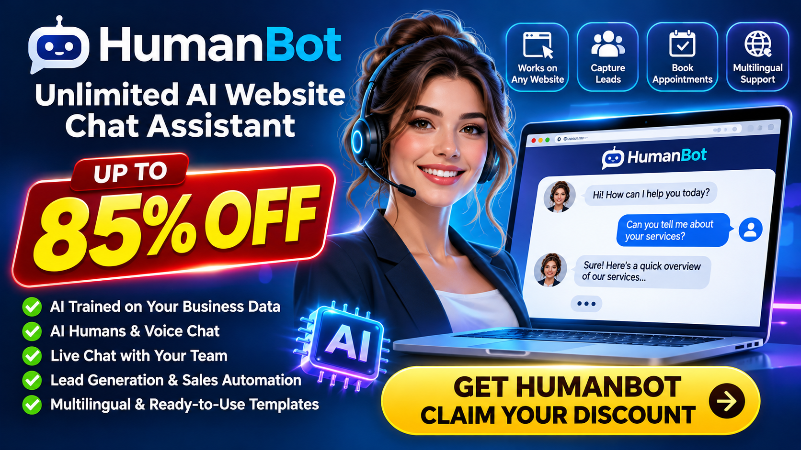

# 🤖 HumanBot Promo Codes – Get Up to 85% OFF Discount (2026)

---

**Looking for a HumanBot promo code, discount code, or special offer?**

Discover the latest HumanBot deal and automate your website's sales, marketing, lead generation, and customer support with AI.

  <a href="https://deal.ink/HumanBot">
    <strong>🔥 CLICK HERE TO CLAIM UP TO 85% OFF HUMANBOT</strong>
  </a>

---

## 📑 Table of Contents

1. [What Is HumanBot?](#what-is-humanbot)
2. [HumanBot Features](#humanbot-features)
3. [How Does HumanBot Work?](#how-does-humanbot-work)
4. [Benefits of Using HumanBot](#benefits-of-using-humanbot)
5. [Who Should Use HumanBot?](#who-should-use-humanbot)
6. [HumanBot Pricing and Discount](#humanbot-pricing-and-discount)
7. [Frequently Asked Questions](#frequently-asked-questions)
8. [Final Verdict](#final-verdict)
9. [Affiliate Disclosure](#affiliate-disclosure)

---

## What Is HumanBot?

HumanBot is an AI-powered website chat assistant designed to help businesses communicate with website visitors, answer questions, collect leads, and support sales and customer service activities.

Unlike a basic chatbot that only follows predefined questions and answers, HumanBot allows you to train its AI using your own business information. You can provide website URLs, PDFs, documents, and knowledge-base content so the assistant can respond to questions related to your products, services, and business.

It also combines AI conversations with live chat, voice-enabled AI humans, chat funnels, multilingual communication, and marketing automation features.

Whether you run an online store, agency, blog, service-based business, or marketing website, HumanBot can help you create a more interactive experience for your visitors.

**Want to try HumanBot at a special discounted price?**

👉 [Get HumanBot – Claim Up to 85% OFF Here](https://deal.ink/HumanBot)

---

## HumanBot Features

HumanBot brings several tools together in one platform. Here are some of its key features.

### 1. AI Chat Trained With Your Own Data

Train the AI assistant using your website URLs, PDFs, documents, and knowledge-base content.

This allows the chatbot to answer questions based on your business information rather than relying only on generic responses.

### 2. Real-Time Voice Chat With AI Humans

HumanBot includes voice-enabled AI human companions that can interact with website visitors using text-to-speech technology.

The platform advertises hundreds of voice options and support for multiple languages, helping businesses create a more conversational experience.

### 3. Live Chat With Unlimited Team Members

You can communicate with visitors through live chat and involve team members in customer conversations.

This is useful when a visitor needs personal assistance or when an AI response needs human support.

### 4. Custom AI Chat Funnel Builder

Create interactive chat funnels using a drag-and-drop builder.

You can guide visitors through questions, choices, and different conversation paths to collect information, recommend products, or encourage them to take action.

### 5. Ready-to-Use Chat Templates

HumanBot provides pre-built chat templates to help users get started without building every conversation from scratch.

These templates can help save setup time and provide ideas for different business requirements.

### 6. Analytics and Chat History

Review chat conversations and access available analytics to understand visitor questions and interactions.

This information can help you identify common customer concerns and improve your website's communication.

### 7. Keyword-Triggered Responses

Set up keyword-based triggers to respond automatically when visitors enter specific words or phrases.

This can help deliver relevant information and guide visitors toward the next step.

### 8. Zapier and Webhook Integrations

HumanBot supports Zapier integration and webhooks to connect chat activities with other business applications.

For example, you can send collected contact details and leads to supported CRM or marketing platforms.

### 9. Multilingual Chat With Location Detection

HumanBot advertises automatic location detection and chat translation to help communicate with visitors in different languages.

This can be especially useful for businesses serving customers from different countries.

### 10. Automated Personalized Messages

Create personalized chat messages using available visitor information, such as their name or location.

Personalized greetings can make conversations feel more relevant and encourage visitors to interact.

### 11. Chat Customization and Branding

Customize the chat window's appearance to better match your website and brand.

Depending on the selected plan, branding options may also allow you to remove HumanBot branding or use your own branding.

### 12. Images, Videos, Coupons, and Product Promotions

HumanBot supports interactive chat content, including images, videos, product links, and promotional offers.

You can use these features to introduce products, share special deals, and encourage visitors to explore your offers.

---

## How Does HumanBot Work?

Getting started with HumanBot is designed to be straightforward. You don't need to build a chatbot from scratch or have advanced programming skills.

Here is a general overview of the process:

**Step 1: Access HumanBot**

Visit the special offer page and choose the available plan that suits your requirements.

👉 [Access the HumanBot Discount Offer](https://deal.ink/HumanBot)

**Step 2: Train Your AI Assistant**

Provide your business information using supported sources such as website URLs, PDFs, documents, or knowledge-base content.

The AI uses this information to respond to questions related to your business.

**Step 3: Customize Your Chat**

Adjust the chatbot's appearance, messages, templates, and available interaction options to suit your website.

**Step 4: Add It to Your Website**

HumanBot is designed to work with different website platforms. Its advertised installation process uses a code snippet that you can add to your website.

**Step 5: Start Engaging Visitors**

Once installed, your chatbot can interact with visitors, answer questions, collect leads, and assist with customer conversations.

You can also use live chat and supported integrations to manage visitor interactions.

---

## Benefits of Using HumanBot

A website can attract visitors through SEO, paid advertising, social media, and other marketing activities. But attracting visitors is only part of the job. You also need to help them find information, understand your products, and take action.

HumanBot aims to make this process easier.

Here are some potential benefits:

- **Automate customer support:** Answer common questions without requiring your team to respond manually to every inquiry.
- **Capture more leads:** Collect contact information through interactive conversations.
- **Support sales activities:** Share product information, links, coupons, and promotional offers directly in chat.
- **Improve visitor engagement:** Give website visitors another way to interact with your business.
- **Serve international visitors:** Use multilingual chat features to communicate with a wider audience.
- **Save time:** Automate repetitive conversations and frequently asked questions.
- **Create additional agency services:** Build chat assistants for clients and offer chatbot setup as a service.
- **Customize the experience:** Adjust chat appearance and available branding options to suit your business.

The actual results will depend on how you configure HumanBot, the quality of your business information, and how visitors interact with your chatbot.

---

## Who Should Use HumanBot?

HumanBot may be useful for different types of online businesses and professionals.

### Digital Marketers

Digital marketers can use chat funnels, lead collection, and promotional messages to engage website visitors and support marketing campaigns.

### Bloggers and Content Creators

Bloggers can add an AI assistant to help readers find information, explore content, and discover relevant products or services.

### E-commerce Store Owners

Online store owners can use chat to answer product questions, share product links, display offers, and help customers during their shopping journey.

### Digital Agencies and Freelancers

Agencies and freelancers can create chatbot solutions for clients and potentially offer chatbot setup and management as an additional service.

### Coaches and Consultants

Coaches and consultants can use chat assistants to answer common questions, collect inquiries, and help visitors explore their services.

### Small Business Owners

Small businesses can use AI chat to provide information and handle repetitive customer questions without needing someone to monitor every conversation manually.

---

## HumanBot Pricing and Discount

One of the interesting aspects of HumanBot is its advertised one-time payment options.

The offer page has promoted different plan levels, including:

| Plan | Advertised allocation |
|---|---|
| Commercial | Up to 100 AI chats for up to 100 websites, pages, or clients |
| Unlimited | Unlimited AI chats and website usage, with additional branding and feature options |

The exact price, plan limits, and included features may vary depending on the active offer and selected checkout option.

### Get Up to 85% OFF HumanBot

If you're considering HumanBot, check the special promotional link below to see the current discount.

🔥 **[CLICK HERE TO CLAIM UP TO 85% OFF HUMANBOT](https://deal.ink/HumanBot)**

Check the final checkout page carefully to confirm the price, plan, included features, and any applicable terms before purchasing.

---

## Frequently Asked Questions

### 1. What is HumanBot used for?

HumanBot is an AI-powered website chat assistant used to automate customer conversations, answer questions, collect leads, support sales, and provide customer assistance.

### 2. Does HumanBot require coding?

HumanBot is advertised as a no-code solution. Its website installation process is designed around adding a code snippet, rather than building a chatbot through programming.

### 3. Can I train HumanBot with my own business information?

Yes. HumanBot supports training its AI using sources such as website URLs, PDFs, documents, and knowledge-base content.

### 4. Can I use HumanBot on multiple websites?

Yes. The available plan determines the number of AI chats and websites or pages you can use. The advertised Commercial plan supports up to 100 AI chats and websites or pages, while the Unlimited plan offers unlimited usage.

Check the current offer for the exact plan limits.

### 5. Does HumanBot support multiple languages?

Yes. HumanBot advertises multilingual chat with location-based language detection and translation. Its text-to-speech functionality also advertises support for a large selection of languages and voices.

### 6. Can I use HumanBot for client projects?

HumanBot advertises a commercial license. The available permissions and usage limits depend on the selected plan, so review the license terms before offering chatbot services to clients.

### 7. Does HumanBot offer live chat?

Yes. HumanBot includes live chat functionality and advertises support for unlimited team members.

### 8. Can I customize HumanBot's branding?

HumanBot provides chat customization options. Some branding features, such as removing HumanBot branding or adding your own, depend on the selected plan.

### 9. Is HumanBot a monthly subscription?

HumanBot has advertised one-time payment options. However, available offers and plan structures can change, so check the checkout page for the current payment terms.

### 10. Does HumanBot offer a money-back guarantee?

HumanBot's advertised offer information has included a 30-day money-back guarantee. Review the current purchase terms and refund conditions before ordering.

---

## Final Verdict

HumanBot brings together several useful website communication and automation features in one platform.

Its ability to train an AI assistant using your own business information is particularly interesting. Instead of relying entirely on generic chatbot responses, businesses can provide their own content to help the AI answer questions relevant to their products and services.

The combination of AI chat, live support, voice-enabled AI humans, chat funnels, multilingual communication, and integrations makes it worth considering for digital marketers, website owners, e-commerce businesses, freelancers, and agencies.

The commercial usage options may also appeal to people who want to offer chatbot setup services to clients.

Of course, a chatbot is only as useful as its setup and the information it receives. You should review the available features, plan limits, and license terms before purchasing.

If you're looking for an AI website chat assistant and want to explore the current promotional offer, check HumanBot through the link below.

🚀 **[GET HUMANBOT – CLAIM UP TO 85% OFF TODAY](https://deal.ink/HumanBot)**

---

## Affiliate Disclosure

This repository contains an affiliate link. If you purchase HumanBot through the link provided in this article, I may earn a commission at no additional cost to you.

I share products and tools that may be useful to online marketers, website owners, bloggers, freelancers, and digital entrepreneurs. Please review the product details and terms before making a purchase.
